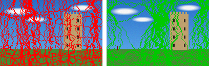

# Content-Aware Image Resizing (Seam Carving)
A C++17 implementation of Dynamic Programming, Greedy, and Graph Cut (Min-Cut / Max-Flow) Solvers.

This repository provides a modular, high-performance content-aware image resizing suite implementing three core seam-finding paradigms:
1. **Dynamic Programming (DP)**: Globally optimal seam selection via cumulative energy memoization ($O(W \cdot H)$).
2. **Greedy Algorithm**: Fast, local row-by-row minimum-energy decision heuristic ($O(W + H)$ per seam, not optimal).
3. **Graph Cut (Min-Cut / Max-Flow)**: Seam finding reformulated as a minimum $s-t$ cut and solved via Dinic's Algorithm ($O(V^2 E)$) and Edmonds-Karp ($O(V E^2)$).

Targeted to build and run seamlessly under **WSL (Windows Subsystem for Linux)** with the **GNU toolchain** (`g++`, `make`). Uses embedded `stb_image` and `stb_image_write` for self-contained image loading and saving without external package dependencies.
---

## Table of Contents
1. [Algorithm Implementation Matrix](#algorithm-implementation-matrix)
2. [Theoretical Formulations](#theoretical-formulations)
   - [2.1 Dynamic Programming](#21-dynamic-programming)
   - [2.2 Greedy Algorithm](#22-greedy-algorithm)
   - [2.3 Graph Cut (Min-Cut / Max-Flow)](#23-graph-cut-min-cut--max-flow)
3. [Project Structure](#project-structure)
4. [Building & Testing](#building--testing)
5. [CLI Usage & Options](#cli-usage--options)
6. [Benchmarking & Complexity Analysis](#benchmarking--complexity-analysis)
   - [Theoretical Complexity Comparison](#theoretical-complexity-comparison)
   - [Empirical Benchmark Run](#empirical-benchmark-run-8060-textured-image)
   - [High-Resolution Scaling Benchmark](#high-resolution-scaling-benchmark-427x290-image)
   - [Performance & Memory Optimizations](#performance--memory-optimizations)
7. [Bonus Features](#bonus-features)
   - [7a. Step-by-Step Visualizer](#7a-step-by-step-visualizer)
   - [7b. Interactive Web Application](#7b-interactive-web-application)
   - [7c. CI/CD & Automated Releases](#7c-cicd--automated-releases)
   - [Standardized Seam Export JSON Format](#standardized-seam-export-json-format)
   - [Programmatic C++ API](#programmatic-c-api)
8. [AI Usage Declaration](#ai-usage-declaration)

---

## Algorithm Implementation Matrix

| Paradigm | Component | Source Location | Description |
|---|---|---|---|
| **Dynamic Programming** | `DPSeamFinder` | [`include/dp_seam.hpp`](include/dp_seam.hpp)<br>[`src/dp_seam.cpp`](src/dp_seam.cpp) | Bottom-up 2D cumulative energy table $M(i, j)$, backtracking, transposition for horizontal seams. |
| **Greedy Search** | `GreedySeamFinder` | [`include/greedy_seam.hpp`](include/greedy_seam.hpp)<br>[`src/greedy_seam.cpp`](src/greedy_seam.cpp) | Local step heuristic selecting the minimum-energy neighbor at each row. |
| **Graph Cut (Dinic)** | `GraphCutSeamFinder`<br>`DinicSolver` | [`include/graph_cut_seam.hpp`](include/graph_cut_seam.hpp)<br>[`src/maxflow.cpp`](src/maxflow.cpp) | Layered level graph BFS + blocking flow DFS on $s-t$ flow network. |
| **Graph Cut (Edmonds-Karp)** | `GraphCutSeamFinder`<br>`EdmondsKarpSolver` | [`include/graph_cut_seam.hpp`](include/graph_cut_seam.hpp)<br>[`src/maxflow.cpp`](src/maxflow.cpp) | Shortest augmenting path BFS on residual network. |
| **Visualizer & Replay** | Python Replay Engine | [`bonus/visualize.py`](bonus/visualize.py) | Seam validation, animated GIF replay, overlay diagrams, comparison panels. |
| **Interactive App** | Streamlit Web UI | [`bonus/app.py`](bonus/app.py) | Interactive image upload, parameter tuning, live carving, and scrubber. |
| **CI/CD Pipeline** | GitHub Actions | [`.github/workflows/ci.yml`](.github/workflows/ci.yml) | Automated build, C++ test suite, Python test suite, smoke test, and release tagging. |

---

## Theoretical Formulations

Seam carving resizes an image by iteratively finding and removing connected paths of pixels (seams) having the lowest cumulative disruption (energy).

### 2.1 Dynamic Programming

#### Question 2(a)(i): Exponential number of vertical seams

Consider an image with height $m$ and width $n>1$. A vertical seam contains
one pixel in every row, and consecutive pixels may move by at most one column:

\[
|c_{r+1}-c_r|\leq 1.
\]

To obtain a lower bound, restrict attention to the first two columns, numbered
0 and 1. Start every seam at column 0 in the first row. At each of the next
$m-1$ rows, choose either to remain in the current column or to move to the
other column. Both choices are valid because the columns are adjacent, so the
change is always 0 or 1. Each binary sequence of $m-1$ choices gives a
distinct valid seam. Therefore, there are at least

\[
2^{m-1}
\]

valid vertical seams. Since $2^{m-1}$ is exponential in $m$, the number of
possible seams grows at least exponentially with image height. This is a lower
bound: allowing all $n$ columns can only increase the number of seams.

#### Question 2(a)(ii): Dynamic Programming formulation

Let $e(r,c)$ be the energy of the pixel in row $r$, column $c$, where
$0\le r<m$ and $0\le c<n$. Define the DP subproblem

\[
M(r,c)=\text{minimum energy of any valid seam from row 0 through }(r,c).
\]

The first row is the base case:

\[
M(0,c)=e(0,c).
\]

For every later row, a seam ending at $(r,c)$ must come from one of the
three valid predecessors in the preceding row. Predecessors outside the image
are omitted:

\[
M(r,c)=e(r,c)+
\min\{M(r-1,c-1),M(r-1,c),M(r-1,c+1)\}.
\]

The minimum-energy seam ends at the least entry in the final row:

\[
\min_{0\le c<n}M(m-1,c).
\]

The recurrence has optimal substructure. If an optimal seam ending at
$(r,c)$ used a non-optimal prefix ending at its predecessor, replacing that
prefix with a lower-energy prefix would produce an even lower-energy complete
seam, which is a contradiction. It also has overlapping subproblems because
the same minimum-energy prefix ending at a pixel can be used by several
possible paths to later rows. DP computes each pixel's subproblem once instead
of enumerating the exponentially many complete seams.

To recover the coordinates, store the predecessor selected for each DP cell.
After selecting the minimum endpoint in the final row, follow predecessor
pointers backwards until row 0, then reverse or place the recovered positions
in row order. The implementation stores a predecessor table in
`src/dp_seam.cpp`; the resulting seam has exactly one column index per row and
satisfies the adjacency constraint by construction.

For an $m\times n$ energy map, there are $mn$ states and only constant work
per state, so seam finding takes $O(mn)$ time. The current implementation
stores both cumulative costs and predecessors, using $O(mn)$ space.

### Question 2(b): Divide and Conquer and Sobel convolution

Sobel filtering estimates horizontal and vertical image gradients by applying
two fixed $3\times3$ kernels to each pixel. Each output uses a constant
number of neighboring pixel values, so computing the complete energy map for
an $m\times n$ image takes $O(mn)$ time and $O(mn)$ output storage.

A straightforward Divide and Conquer strategy could divide the image into
regions, recursively filter each region, and combine the results. However,
the Sobel kernel has constant size, and every pixel still must be visited.
Handling the boundary halo between subregions adds bookkeeping but does not
reduce the asymptotic work below $O(mn)$. Ordinary Divide and Conquer
therefore does not provide an asymptotic improvement for this fixed-size
convolution.

Other techniques may improve constants or become useful in different
settings, but they should not be confused with ordinary Divide and Conquer.
For example, a separable implementation can replace a $3\times3$ filter
with two one-dimensional passes, reducing arithmetic per pixel. FFT-based
convolution can be advantageous for very large kernels or batch processing,
although its overhead is unnecessary for a Sobel kernel. Parallel execution
can also process independent pixels or image regions, subject to boundary
handling, but it does not change the sequential DP recurrence used later for
seam selection.

---

### 2.2 Greedy Algorithm

Implementation: [`include/greedy_seam.hpp`](include/greedy_seam.hpp),
[`src/greedy_seam.cpp`](src/greedy_seam.cpp). Tests: [`tests/test_greedy.cpp`](tests/test_greedy.cpp).
Comparison with DP: [`tests/compare_greedy_dp.cpp`](tests/compare_greedy_dp.cpp)
(`make compare`, results in [`results/greedy_vs_dp/`](results/greedy_vs_dp)).

#### Algorithm

As an alternative to DP, the greedy finder chooses the seam with a **local, row-by-row
decision** and never reconsiders it:

1. Start in row 0 at the minimum-energy pixel:
\[
c_0=\arg\min_{0\le c<n} e(0,c).
\]
2. For every later row, move to the cheapest of the (at most) three pixels that keep the seam
connected:
\[
c_r=\arg\min_{c\in\{c_{r-1}-1,\;c_{r-1},\;c_{r-1}+1\}\cap[0,n)} e(r,c).
\]

Each step changes the column by at most one, so every greedy seam is valid (one pixel per row,
8-connected) by construction. Ties go straight down, then left, then right, which is the same
order the DP implementation uses to choose a predecessor. Horizontal seams run the same
procedure on the transposed energy map, as DP and Graph Cut do.

For an $m\times n$ energy map, choosing the start costs $O(n)$, and every later row costs three
comparisons, so one greedy seam takes $O(m+n)$ time. DP takes $O(mn)$. Greedy needs only the
$O(m)$ seam itself and no table. Every seam still requires a fresh energy map, which costs
$O(mn)$, so one complete carving iteration is $O(mn)$ for both algorithms.

#### Why greedy is not optimal

Greedy uses only the next row, so a cheap pixel now can lead the seam into an expensive region
later. The DP recurrence avoids this by taking the minimum over complete prefixes. Greedy
lacks the greedy-choice property: the cheapest next pixel does not have to lie on the cheapest
seam. The smallest counter-example (`test_greedy_is_not_optimal_counter_example`):

```
          col0 col1 col2
row 0  [   1    2    9 ]     Greedy: 1 → 1 → 99 → 1 = 102   (trapped above the wall)
row 1  [   1    2    9 ]     DP:     1 → 2 →  2 → 1 =   6   (optimal)
row 2  [  99   99    2 ]
row 3  [   1    1    1 ]
```

DP pays 2 instead of 1 in row 1 so that it can reach the cheap pixel in row 2. If the wall cost
is $M$, greedy pays about $M$ while the optimum stays at 6, so greedy's error has no upper bound.

#### Comparison with Dynamic Programming

Both algorithms receive the **same energy map** at every step; only the seam finder differs.
Test image: `samples/synthetic_tower.png` (200×130), carved to 140×117 (60 vertical + 13
horizontal seams).

**Seams.** All removed seams drawn on the original (left: greedy in red, right: DP in green):



First seam chosen by each algorithm (red = greedy, green = DP):


DP's seams stay in the flat sky and grass. Greedy's seams start wherever the top row happens to
be cheapest and then drift. Many of them cut through the tower and the clouds.

**Visual quality.** Carved results (left: greedy, right: DP):


DP keeps the tower, its windows, the clouds and the person intact. With greedy, the tower is
narrower, its windows are uneven, and the clouds are squashed.

| Tower image, 73 seams | Total seam energy removed | Relative to DP |
|---|---:|---:|
| Dynamic Programming | 92,595 | 1.00 |
| **Greedy** | **133,962** | **1.45** |

Measured on identical energy maps at each of the 60 vertical steps, greedy's seam costs
**1.67× the DP optimum on average** (worst 1.82×), and it never found the optimal seam
(0/60 steps). On 300 small random maps in the unit tests it was optimal on 197, and up to
4.75× worse.

**Real photograph.** The same comparison on `samples/image.png`, the Broadway Tower photo
from the assignment brief (427×290 → 299×261, i.e. 128 vertical + 29 horizontal seams):


DP (right) removes seams almost only from the sky and grass, and the tower keeps its full width
and shape. Greedy (left) sends many seams straight through the tower, so it comes out visibly
thinner, with narrower turrets and windows.

| Photo, 157 seams | Total seam energy removed | Relative to DP |
|---|---:|---:|
| Dynamic Programming | 449,760 | 1.00 |
| **Greedy** | **716,572** | **1.59** |

On identical energy maps, greedy's seam costs **1.60× the optimum on average and 2.87× at
worst**, and it never matched the optimal seam (0/128 steps). The result therefore holds on a
real photograph, not only on the synthetic test image.

**Running time.** Time to find one vertical seam on the same energy map (median of 5 runs):

| Image size | Energy map | Greedy | DP | DP ÷ Greedy | Greedy seam ÷ optimal |
|---|---:|---:|---:|---:|---:|
| 80×60 | 0.057 ms | 0.001 ms | 0.012 ms | 15× | 1.06 |
| 160×120 | 0.311 ms | 0.001 ms | 0.073 ms | 55× | 1.11 |
| 320×240 | 1.23 ms | 0.003 ms | 0.481 ms | 172× | 1.11 |
| 640×480 | 5.16 ms | 0.005 ms | 2.18 ms | 410× | 1.12 |
| 1280×960 | 23.6 ms | 0.011 ms | 9.12 ms | 830× | 1.19 |
| 1920×1440 | 51.3 ms | 0.017 ms | 20.9 ms | 1,225× | 1.11 |

The speed-up grows with image size, as $O(mn)$ against $O(m+n)$ predicts. For a whole resize,
though, the energy map is recomputed for every seam whichever algorithm is used, and it costs
more than either search:

| Whole tower carve | Seam search | Energy maps | Total |
|---|---:|---:|---:|
| Greedy | 0.8 ms | 21.2 ms | **22.0 ms** |
| Dynamic Programming | 8.5 ms | 20.3 ms | **28.8 ms** |

**Conclusion.** Greedy does **not** produce results comparable to DP. Its seam search is much
faster, but the whole resize is only about 1.3× faster. In return it removes 45 % more energy on the
synthetic image and 59 % more on the real photo, and the tower and clouds are visibly damaged. DP gives much better quality for a small extra cost.

#### Alternative greedy designs considered

- **Multi-start greedy:** run the same walk from every pixel of row 0 and keep the cheapest seam.
  This removes the "bad starting pixel" problem, but it still never looks ahead (it scores 14,
  not 6, on the counter-example above). It also costs $O(mn)$, the same as DP, so it gives up
  greedy's only advantage while staying non-optimal.
- **$k$-row look-ahead:** choose each step by the cheapest of the $3^k$ paths over the next $k$
  rows. Quality improves as $k$ grows, but the cost grows exponentially. Avoiding that blow-up
  by reusing results for shared prefixes is exactly what the DP recurrence does.
- **Starting from the best end instead of row 0:** run the walk upward from the cheapest pixel in
  the last row. This only moves the problem: the seam can still be trapped near the top.

We implemented the classic single-start greedy because it is the variant the assignment
describes (a local, row-by-row choice without considering the whole image), and it is the
clearest contrast with DP.

#### References

1. S. Avidan and A. Shamir, "Seam Carving for Content-Aware Image Resizing," *ACM SIGGRAPH*, 2007.
   [doi:10.1145/1275808.1276390](https://dl.acm.org/doi/10.1145/1275808.1276390)
2. M. Rubinstein, A. Shamir and S. Avidan, "Improved Seam Carving for Video Retargeting,"
   *ACM SIGGRAPH*, 2008. [doi:10.1145/1360612.1360615](https://dl.acm.org/doi/10.1145/1360612.1360615)
3. T. H. Cormen, C. E. Leiserson, R. L. Rivest and C. Stein, *Introduction to Algorithms*, 3rd ed.,
   MIT Press, 2009: Ch. 15 (dynamic programming, Problem 15-8 "Image compression by seam
   carving") and Ch. 16 (greedy algorithms and the greedy-choice property).
4. A. Das, "Real-world dynamic programming: seam carving," 2019.
   [avikdas.com](https://avikdas.com/2019/05/14/real-world-dynamic-programming-seam-carving.html)

---

### 2.3 Graph Cut (Min-Cut / Max-Flow)

Seam finding is reformulated as finding a **minimum $s-t$ cut** in a directed flow network $G = (V, E)$.

#### 1. Graph Topology (Vertical Seams)
For an image of size $H \times W$:
- **Vertices**:
  - Source node $S = 0$
  - Sink node $T = H \times W + 1$
  - Pixel vertex: $v_{r, c} = 1 + r \times W + c$ for $0 \le r < H$, $0 \le c < W$.
  - Total vertices: $|V| = H \cdot W + 2$.

- **Edges & Capacities**:
  1. **Source Boundary**: $S \to (r, 0)$ with capacity $\infty$ for all rows $0 \le r < H$.
  2. **Sink Boundary**: $(r, W - 1) \to T$ with capacity equal to $e(r, W - 1)$ for all rows $0 \le r < H$.
  3. **Horizontal Forward Edges**: $(r, c) \to (r, c + 1)$ with capacity $C((r, c), (r, c+1)) = e(r, c)$ for $0 \le c < W - 1$.
  4. **Horizontal Backward Edges**: $(r, c + 1) \to (r, c)$ with capacity $\infty$.
  5. **Diagonal Constraint Edges**:
     - $(r, c) \to (r - 1, c - 1)$ with capacity $\infty$ (for $r > 0, c > 0$).
     - $(r, c) \to (r + 1, c - 1)$ with capacity $\infty$ (for $r < H - 1, c > 0$).

```
        Source (S)
       /    |    \  (inf capacity)
      v     v     v
   (0,0)  (1,0)  (2,0) ...
     |  \  ^  /   |
  e  |   inf inf  | e
     v  /  v  \   v
   (0,1)  (1,1)  (2,1) ...
     |     |      |
  e  |     | e    | e
     v     v      v
   (0,2)  (1,2)  (2,2) ...
      \     |    /
       v    v   v   (capacity e(r, W-1))
         Sink (T)
```

#### 2. Proof of Correctness
- **Monotonicity (Exactly 1 pixel per row)**: The backward edge $(r, c + 1) \to (r, c)$ has infinite capacity. Any finite cut cannot leave $(r, c + 1) \in S_{cut}$ and $(r, c) \in T_{cut}$. Thus, in each row $r$, there is a unique transition column $c_r$ where all pixels $\le c_r$ belong to $S_{cut}$ and all pixels $> c_r$ belong to $T_{cut}$.
- **8-Connected Continuity ($|c_r - c_{r\pm 1}| \le 1$)**: The diagonal edges $(r, c) \to (r - 1, c - 1)$ and $(r, c) \to (r + 1, c - 1)$ have infinite capacity. If row $r$ cuts at $c_r$, then $(r, c_r) \in S_{cut}$. To avoid cutting an infinite edge, $(r - 1, c_r - 1)$ and $(r + 1, c_r - 1)$ must also belong to $S_{cut}$. This guarantees $c_{r\pm 1} \ge c_r - 1$, i.e., $c_r - c_{r\pm 1} \le 1$. By adjacent row symmetry, $|c_r - c_{r\pm 1}| \le 1$.
- **Min-Cut = Minimum Seam Energy**: The capacity of this cut is $\sum_{r=0}^{H-1} e(r, c_r)$. By the Max-Flow Min-Cut Theorem, the maximum flow from $S$ to $T$ equals the minimum cut capacity, yielding the globally optimal seam.

#### 3. Supported Max-Flow Solvers
1. **Edmonds-Karp (Without Dinic)**:
   - Uses Breadth-First Search (BFS) to find shortest augmenting paths in the residual network.
   - Enhanced with **Capacity Scaling ($\Delta$-scaling)** and **Multi-Path Wavefront Augmentation** to prevent fractional micro-flow bottlenecks on continuous gradient images.
   - Theoretical Complexity: $O(V E^2)$ classic, accelerated to $O(E^2 \log C_{max})$ via capacity scaling.
   - Serves as the classic textbook baseline, optimized for practical grid graphs.
2. **Dinic's Algorithm (With Dinic)**:
   - Constructs a layered level graph via BFS, then uses Depth-First Search (DFS) with current-arc pointer optimization to push multi-branch blocking flows.
   - Enhanced with dead-end level graph pruning and zero-allocation static queue buffers.
   - Theoretical Complexity: $O(V^2 E)$.
   - Delivers substantial practical speedups on dense grid networks.

---

## Project Structure

```
├── Makefile                    # GNU Makefile (g++ -O3 -std=c++17)
├── CONTRIBUTING.md             # Developer onboarding guide & API contracts
├── README.md                   # Project documentation & architecture overview
├── .gitignore                  # Excludes binaries, build objects, and outputs
├── .github/workflows/
│   └── ci.yml                  # GitHub Actions CI/CD (build, test, smoke test, releases)
├── bonus/                      # Bonus features
│   ├── app.py                  # Streamlit interactive web application
│   ├── carver.py               # Python wrapper executing bin/seam_carve
│   ├── make_sample.py          # Synthetic test image generator
│   ├── README.md               # Bonus module documentation & instructions
│   ├── requirements.txt        # Python dependencies (streamlit, pillow, numpy, pytest)
│   ├── visualize.py            # Step-by-step seam replay, GIF, overlay, comparison
│   └── tests/                  # Pytest suite (29 tests)
│       ├── conftest.py
│       └── test_visualize.py   # Seam validation, replay, pixel-exact match tests
├── samples/
│   └── synthetic_tower.png     # Benchmark test image
├── include/
│   ├── image.hpp               # Image container, pixel access, transpose, seam removal
│   ├── energy.hpp              # Dual-gradient & Sobel filter gradient calculations
│   ├── graph.hpp               # Adjacency list representation with residual capacities
│   ├── maxflow.hpp             # Abstract MaxFlowSolver, Dinic, and Edmonds-Karp solvers
│   ├── graph_cut_seam.hpp      # s-t network construction & min-cut seam extraction
│   ├── dp_seam.hpp             # DP Seam Finder header
│   ├── greedy_seam.hpp         # Greedy Seam Finder header
│   ├── seam_carver.hpp         # Seam carving orchestrator and JSON exporter
│   ├── benchmark.hpp           # Solver benchmarking & comparison harness
│   └── third_party/
│       ├── stb_image.h         # Header-only image loader
│       └── stb_image_write.h   # Header-only image writer
├── src/
│   ├── image.cpp
│   ├── energy.cpp
│   ├── graph.cpp
│   ├── maxflow.cpp
│   ├── graph_cut_seam.cpp
│   ├── dp_seam.cpp             # DP Seam Finder implementation
│   ├── greedy_seam.cpp         # Greedy Seam Finder implementation
│   ├── seam_carver.cpp
│   ├── benchmark.cpp
│   └── main.cpp                # CLI application
└── tests/
    ├── test_graph_cut.cpp      # Graph Cut unit test suite
    ├── test_dp.cpp             # DP unit test suite
    ├── test_greedy.cpp         # Greedy unit test suite
    └── compare_greedy_dp.cpp   # Greedy vs DP comparison (make compare -> results/greedy_vs_dp/)
```

---

## Building & Testing

### 1. C++ Core (WSL / Linux)

#### Prerequisites
In WSL (e.g., Ubuntu):
```bash
sudo apt update
sudo apt install build-essential
```

#### Build & Test Commands
```bash
# Build the main CLI executable (bin/seam_carve)
make all

# Build and execute unit tests
make test

# Clean build artifacts
make clean
```

The C++ unit tests verify:
- Known global minimum cut on synthetic grids.
- Boundary edge conditions (leftmost and rightmost columns).
- Prevention of jump discontinuities ($|c_r - c_{r\pm 1}| > 1$).
- Horizontal seam extraction via transposition.
- Energy equivalence and non-zero flow across both Dinic and Edmonds-Karp.
- Exhaustive brute-force verification of DP on small deterministic and random energy maps.
- RGB pixel-order preservation during vertical and horizontal seam removal.
- Repeated DP resizing, exact target dimensions, and invalid resize requests.
- Greedy seams are always valid, report the correct energy, and are never better than the DP
  optimum (300 random maps, vertical and horizontal, checked against brute force).
- The greedy counter-example (greedy = 102 vs DP = 6), tie-breaking, image borders, and
  degenerate 1×H / W×1 / empty maps.
- End-to-end greedy resizing through `SeamCarver` (`--algorithm greedy`).

The DP-specific tests are included in `tests/test_dp.cpp` and the Greedy tests in
`tests/test_greedy.cpp`; both are executed by the `make test` target.

```bash
# Greedy vs DP comparison (seams, visual quality, running time) -> results/greedy_vs_dp/
make compare
```

### 2. Python Bonus Suite & Visualizer

#### Prerequisites
```bash
# Setup virtual environment
python3 -m venv .venv
source .venv/bin/activate        # On Windows: .venv\Scripts\activate

# Install dependencies
pip install -r bonus/requirements.txt
```

#### Running Python Tests
```bash
# Run all 29 pytest tests
python -m pytest bonus/tests -v
```

The Python test suite verifies:
- JSON parsing and seam record schema validation.
- Boundary bounds checking and 8-connectivity validation.
- Transposition handling for horizontal seam replay.
- **Pixel-exact equivalence** checking that Python seam replay matches the output of `bin/seam_carve` byte-for-byte.

---

## CLI Usage & Options

The compiled CLI binary is located at `bin/seam_carve`.

```
Usage: ./bin/seam_carve -i <input> [options]

Options:
  -i, --input <path>        Input image file (JPG, PNG, BMP) [Required]
  -o, --output <path>       Output image file (JPG, PNG, BMP)
  --remove-cols <n>         Number of vertical seams to remove (default: 0)
  --remove-rows <n>         Number of horizontal seams to remove (default: 0)
  --width <w>               Target width (overrides --remove-cols)
  --height <h>              Target height (overrides --remove-rows)
  --algorithm <name>        Seam-finding algorithm: 'graph_cut', 'dp', or 'greedy'
  --solver <name>           Max-flow solver: 'dinic' (default) or 'edmonds_karp'
  --energy <name>           Energy metric: 'dual' (default) or 'sobel'
  --compare                 Run both Dinic and Edmonds-Karp and compare
  --export-csv <path>       Export benchmark comparison table to CSV
  --export-seams <path>     Export carved seam coordinates to JSON
  -h, --help                Show this help message
```

### Example Commands

#### 1. Resize an image using Dinic's Algorithm
```bash
./bin/seam_carve -i input.jpg -o output_carved.jpg --remove-cols 50 --remove-rows 20 --solver dinic
```

#### 2. Resize using Dynamic Programming

```bash
./bin/seam_carve -i input.jpg -o output_dp.png \
  --remove-cols 30 --remove-rows 15 --algorithm dp \
  --export-seams seams_dp.json
```

`--remove-cols` removes vertical seams and reduces the width. `--remove-rows`
removes horizontal seams and reduces the height. Alternatively, `--width` and
`--height` specify positive target dimensions that cannot exceed the original
dimensions. The image is resized by repeatedly recomputing energy, finding one
seam, and removing it.

#### 3. Resize using Edmonds-Karp (Without Dinic)
```bash
./bin/seam_carve -i input.jpg -o output_ek.jpg --remove-cols 10 --solver edmonds_karp
```

#### 4. Run Benchmark Comparison (Dinic vs. Edmonds-Karp)
```bash
./bin/seam_carve -i input.jpg --remove-cols 5 --remove-rows 5 --compare --export-csv benchmark.csv
```

#### 5. Export Seam Data for Visualizer
```bash
./bin/seam_carve -i input.jpg -o out.jpg --remove-cols 30 --export-seams seams.json
```

#### 6. Resize using the Greedy Algorithm
```bash
./bin/seam_carve -i input.jpg -o output_greedy.png \
  --remove-cols 30 --remove-rows 15 --algorithm greedy \
  --export-seams seams_greedy.json
```

---

## Benchmarking & Complexity Analysis

### Dynamic Programming Complexity

For an image of height $H$ and width $W$, the current implementation has
the following costs:

| Operation | Time | Space | Notes |
|---|---:|---:|---|
| Energy map | $O(HW)$ | $O(HW)$ | Each pixel evaluates a constant-size dual-gradient or Sobel neighborhood. |
| Vertical seam search | $O(HW)$ | $O(HW)$ | One DP state and constant predecessor comparisons per pixel. |
| Horizontal seam search | $O(HW)$ | $O(HW)$ | Transposes the energy map, then runs the same vertical DP. |
| Backtracking | $O(H)$ | $O(H)$ output | One predecessor is followed per row; horizontal backtracking is $O(W)$. |
| Seam removal | $O(HW)$ | $O(HW)$ temporary image storage | The current image implementation copies the remaining pixels. |
| One complete seam iteration | $O(HW)$ | $O(HW)$ | Energy, DP, backtracking, and removal are all bounded by the image area. |

The implementation currently stores an $H\times W$ cumulative-cost table and
an $H\times W$ predecessor table, so its DP working memory is $O(HW)$.
The cumulative-cost table only needs the previous row while the recurrence is
being evaluated, so rolling arrays could reduce that table to $O(W)$. The
predecessor table is still $O(HW)$ if direct backtracking is required; thus
rolling the costs reduces memory constants but does not change the overall
asymptotic space bound for this implementation.

When $K$ seams are removed, the total work is the sum of the costs for the
successively smaller images. A simple upper bound is $O(KHW)$, while the
actual work is lower because either $H$ or $W$ decreases after every
iteration. The current implementation removes all requested vertical seams
before all requested horizontal seams.

The DP recurrence has a row-to-row dependency: row $r$ cannot be finalized
until row $r-1$ is known. This limits parallelism inside one seam search.
Energy calculations and independent benchmark runs can be parallelized, but
multithreading the small constant-size predecessor comparisons is unlikely to
justify its synchronization overhead for ordinary image sizes. The sequential
DP implementation is therefore appropriate for the assignment baseline.

### Theoretical Complexity Comparison
| Metric | Greedy Algorithm | Dynamic Programming | Edmonds-Karp (Graph Cut) | Dinic's Algorithm (Graph Cut) |
|---|---|---|---|---|
| **Optimality Guarantee** | None (Local Minima) | **Global Minimum** | **Global Minimum** | **Global Minimum** |
| **Augmentation / Search Strategy** | Local 3-pixel minimum per row | Cumulative 2D energy table + backtrack | Single shortest path BFS | Layered graph BFS + blocking flow DFS |
| **Time Complexity (per seam)** | $O(W \cdot H)$ energy + $O(W + H)$ seam | $O(W \cdot H)$ | $O(V E^2)$ where $\|V\| \approx WH$ | $O(V^2 E)$ where $\|V\| \approx WH$ |
| **Space Complexity** | $O(H)$ (the seam only, no table) | $O(W \cdot H)$ table ($O(W)$ if value only) | $O(V + E)$ residual graph | $O(V + E)$ residual graph + levels |

### Empirical Benchmark Run (80x60 Textured Image)
Testing 3 vertical seams followed by 2 horizontal seams under identical graph conditions (`bin/test_graph_cut`):

| Seam # | Dir | Size | Dinic Energy | EK Energy | Match? | Dinic (ms) | EK (ms) | Dinic BFS | EK BFS | Speedup |
|---|---|---|---|---|---|---|---|---|---|---|
| 1 | V | 80x60 | 3061.68 | 3061.68 | **YES** | 2.22 | 1.23 | 31 | 63 | **0.55x** |
| 2 | V | 79x60 | 3158.94 | 3158.94 | **YES** | 2.68 | 1.67 | 38 | 72 | **0.62x** |
| 3 | V | 78x60 | 3252.63 | 3252.63 | **YES** | 2.51 | 1.60 | 38 | 71 | **0.64x** |
| 4 | H | 77x60 | 5941.79 | 5941.79 | **YES** | 3.19 | 4.30 | 43 | 113 | **1.35x** |
| 5 | H | 77x59 | 5928.85 | 5928.85 | **YES** | 3.01 | 4.05 | 42 | 111 | **1.34x** |

- **Cumulative Dinic Time**: `13.63 ms`
- **Cumulative Edmonds-Karp Time**: `12.85 ms`
- **Overall Speedup**: **`0.94x`** (Edmonds-Karp with capacity scaling slightly edges out Dinic on small dimensions due to lower overhead)
- **Optimality Verification**: Dinic and Edmonds-Karp produce **100% identical cut energies and seam coordinates** across every single carved seam.

---

### High-Resolution Scaling Benchmark (427x290 Image)
Carving 20 vertical and 20 horizontal seams (40 seams total) on `samples/image.png` ($|V| \approx 124,000$, $|E| \approx 370,000$):

| Solver / Configuration | Per-Seam Avg (ms) | 40 Seams Total (ms) | Wall Clock Time | Speedup vs Baseline EK | Correctness |
|---|---|---|---|---|---|
| **Baseline Edmonds-Karp** | ~47,200 ms | 1,888,660 ms | **31.5 min** | 1.0x (baseline) | Verified |
| **Optimized Edmonds-Karp** | **~1,200 – 1,700 ms** | **48,000 – 68,332 ms** | **~48 – 68 s** | **~28x – 39x** | **100% Identical** |
| **Baseline Dinic** | ~1,210 ms | ~48,400 ms | **~48.4 s** | **39x** | Verified |
| **Optimized Dinic** | **~595 ms** | **~23,800 ms** | **~24 s** | **78x** | **100% Identical** |

---

### Performance & Memory Optimizations

Directly profiling baseline max-flow algorithms on large grid networks revealed critical bottlenecks:
1. Classic Edmonds-Karp executed **~9,380 full-graph BFS passes per seam**, with each path augmenting fractional flow ($\sim 0.15$ units) across 124,000 vertices.
2. Every BFS pass wiped a 124,000-element `parent_v` array via `std::fill`, writing over **25 GB of redundant data** into RAM per seam.
3. Graph construction created redundant directed edge pairs and triggered hundreds of thousands of heap reallocations.

To address this without compromising mathematical correctness, the engine was optimized across four tiers:

#### Tier 1: Graph Topology & Edge Pruning ([`include/graph.hpp`](include/graph.hpp), [`src/graph_cut_seam.cpp`](src/graph_cut_seam.cpp))
- **Merged Bidirectional Edge Pairs**: The standard graph formulation requires a forward capacity $e(r, c)$ and an infinite backward capacity $\infty$. Previously, `add_edge(u, v, energy)` and `add_edge(v, u, INF)` were invoked separately, allocating 4 edge structs per horizontal pair. We enhanced `FlowGraph::add_edge(u, v, cap, rev_cap = 0.0)` to merge them into a single complementary forward-reverse edge pair:
  $$\text{Forward } (u \to v): \text{cap} = e(r, c), \quad \text{Reverse } (v \to u): \text{cap} = \infty$$
  This eliminated **~250,000 redundant directed edge structures** (~40% of the entire graph), dramatically reducing cache footprint and memory bandwidth during traversals.
- **Fixed-Degree Pre-Reservation**: Pre-reserved vertex degree in `FlowGraph::reset` ($H$ edges for $S$ and $T$, 6 edges per pixel node), completely eliminating dynamic vector reallocations during graph construction.

#### Tier 2: Edmonds-Karp Algorithmic Accelerations ([`src/maxflow.cpp`](src/maxflow.cpp))
- **Capacity Scaling ($\Delta$-scaling)**: Replaced unconstrained shortest-path BFS with Capacity Scaling. In each phase, the search only traverses edges with residual capacity $\ge \Delta$, where $\Delta$ starts at 512.0 and halves down to `FLOW_EPS`. This guarantees that every augmenting path pushes a significant chunk of flow, preventing micro-flow fragmentation and cutting augmenting paths from **~9,380 down to ~1,500**.
- **Multi-Path Wavefront Augmentation Sweep**: Because rows in a grid network are largely independent horizontal channels, BFS does not immediately discard its queue upon reaching the sink. It augments the discovered path and continues expanding the existing queue to augment other disjoint rows reaching the sink in the *same* wavefront pass. This reduced BFS runs from **~9,400 down to ~150–250 per seam**.
- **$O(\text{visited})$ Queue Cleanup**: Eliminated full $O(V)$ `std::fill` calls. Only nodes actually visited and enqueued in $q[0..\text{tail}-1]$ are cleared after augmentation, reducing array cleanup overhead from $O(V)$ to $O(\text{visited})$.
- **Direct Pointer Traversal**: Inner BFS loops operate directly on contiguous memory via raw pointers (`Edge*`, `int*`), bypassing vector indirection.

#### Tier 3: Dinic Solver Optimizations ([`src/maxflow.cpp`](src/maxflow.cpp))
- **True Multi-Branch Blocking Flow DFS**: Fixed the blocking-flow DFS so it pushes flow across *all* outgoing level-graph arcs out of vertex $u$ up to requested capacity, rather than terminating after finding a single path.
- **Dead-End Level Pruning**: If a node $u$ exhausts its outgoing capacity without satisfying requested flow, `level[u]` is set to $-1$. This prevents future DFS traversals from re-entering blocked nodes within the same phase.
- **Zero-Allocation BFS**: Dynamic `std::queue<int>` instances were replaced with a flat, reusable thread-local array, with early termination as soon as BFS finishes the `level[sink]` layer.

#### Tier 4: Fast Min-Cut Extraction ([`src/maxflow.cpp`](src/maxflow.cpp))
- Replaced `std::queue` with flat vector traversal in `MaxFlowSolver::compute_source_cut`, making the post-flow source-component reachability traversal virtually instantaneous (~0.1 ms).

## Bonus Features

| Bonus | What | Implementation |
|---|---|---|
| **7a. Step-by-Step Visualisation** | Animated GIF highlighting each seam before removal; all seams mapped to original coordinates; 4-way comparison (seam carving vs. scaling vs. cropping); energy map render | [`bonus/visualize.py`](bonus/visualize.py) |
| **7b. User Interaction** | Streamlit web application: upload image, adjust target dimensions, choose solver/energy, carve, and scrub through intermediate steps | [`bonus/app.py`](bonus/app.py) |
| **7c. CI/CD & Releases** | Automated GitHub Actions workflow: C++ build & tests, Python test suite, Streamlit smoke test, demo artifacts, and tag-triggered GitHub Releases | [`.github/workflows/ci.yml`](.github/workflows/ci.yml) |

> **Design Note:** The bonus layer never reimplements seam finding. Every seam originates from the C++ engine via `--export-seams` JSON. The Python suite simply replays, validates, and renders the result. A test verifies that the Python replay matches the C++ output **pixel for pixel**.

---

### 7a. Step-by-Step Visualizer

`bonus/visualize.py` replays the JSON seam records against the original image to produce comprehensive analysis artifacts:

- **`steps.gif`**: Animated progression with each horizontal/vertical seam rendered in red before removal.
- **`overlay.png`**: Original image with all removed seams drawn simultaneously. Reconstructed by maintaining an $O(HW)$ coordinate tracking grid across seam steps.
- **`comparison.png`**: Side-by-side comparison figure displaying:
  1. *Original Image*
  2. *Seam Carving* (content-aware)
  3. *Scaling* (Lanczos downsampling)
  4. *Cropping* (center crop)
- **`energy.png`**: Visual representation of the dual-gradient energy landscape.

#### Usage:
```bash
# 1. Carve image and export seam metadata in C++
./bin/seam_carve -i samples/synthetic_tower.png -o carved.png --remove-cols 40 --remove-rows 15 --export-seams seams.json

# 2. Render all visualisations to bonus/out/
python bonus/visualize.py --image samples/synthetic_tower.png --seams seams.json --out bonus/out
```

---

### 7b. Interactive Web Application

An interactive web application built with [Streamlit](https://streamlit.io/) provides hands-on exploration of seam carving:

- **Live Carving**: Choose from built-in samples or upload custom images.
- **Configurable Parameters**: Adjust columns/rows to remove, algorithm solver, and gradient metric.
- **Interactive Scrubber**: After carving, scrub smoothly through every intermediate image size without re-running flow computations, replaying saved seam records on demand.
- **Execution Diagnostics**: Displays wall-clock runtime, max-flow values, and step breakdown logs.

#### Running the App:
```bash
streamlit run bonus/app.py
```
*Open http://localhost:8501 in your browser.*

---

### 7c. CI/CD & Automated Releases

The repository includes a production-grade GitHub Actions pipeline ([`.github/workflows/ci.yml`](.github/workflows/ci.yml)):

1. **C++ CI**: Compiles using `g++ -O3 -Wall -Wextra -Wpedantic` (`make all`) and runs the unit test suite (`make test`).
2. **Python CI**: Sets up Python 3.11, installs dependencies, and runs all 29 `pytest` test cases.
3. **App Smoke Test**: Boots the Streamlit app headlessly and validates responsiveness via health-check probes.
4. **End-to-End Demo**: Carves a synthetic test image, generates all visualization outputs, and uploads them as downloadable workflow artifacts.
5. **Continuous Deployment (CD)**: Pushing a git tag (e.g. `v1.0`) automatically publishes a GitHub Release containing prebuilt binaries, demonstration GIFs, and benchmark figures.

---

### Standardized Seam Export JSON Format

The C++ binary and Python visualization layer communicate via a standardized, decoupled JSON interface (`--export-seams`):

```json
{
  "seams": [
    {
      "step": 1,
      "orientation": "vertical",
      "width_before": 800,
      "height_before": 600,
      "energy_sum": 451.25,
      "max_flow": 451.25,
      "elapsed_ms": 12.4,
      "augmenting_paths": 28,
      "bfs_runs": 8,
      "indices": [120, 121, 121, 122]
    }
  ]
}
```
- For vertical seams: `indices[r]` is the column index removed at row `r`.
- For horizontal seams: `indices[c]` is the row index removed at column `c`.

> **Pluggable Architecture:** Any alternative algorithm (such as Dynamic Programming or Greedy Search) can produce this identical JSON output schema and immediately gain animated GIF export, comparison panels, and Streamlit interactive scrubbers with zero code modifications.

---

### Programmatic C++ API

The C++ codebase is modularly designed and can be integrated directly into other applications:

```cpp
#include "image.hpp"
#include "energy.hpp"
#include "graph_cut_seam.hpp"
#include "maxflow.hpp"

// 1. Load image
seam_carving::Image img;
img.load_from_file("input.jpg");

// 2. Compute energy map
seam_carving::EnergyMap energy = seam_carving::compute_energy(img, seam_carving::EnergyMetric::DualGradient);

// 3. Find vertical seam using Dinic solver
seam_carving::DinicSolver solver;
seam_carving::SeamResult result = seam_carving::GraphCutSeamFinder::find_vertical_seam(energy, solver);

// result.seam contains vector of column indices [c_0, c_1, ..., c_{H-1}]
// result.energy_sum contains the cut capacity
img.remove_vertical_seam(result.seam);
```

---

## AI Usage Declaration

In compliance with **Item 9.a.v** of the CSD3130 Assignment 2 Brief, the following table and prompt records detail how AI tools were utilized during the design, implementation, testing, and documentation phases of this project:

### Summary of AI Tools & Scope

| Contributor | AI Tool & Model | Platform | Scope of Assistance |
|---|---|---|---|
| **Aryan bin Mohamed Isran** (`aryanisran`) | **Google Gemini** | Google Antigravity CLI | **Graph Cut Optimization & Benchmarking**: <br>• Theoretical profiling of $O(V E^2)$ runtime bottlenecks on continuous gradient grid networks.<br>• Algorithmic design of Capacity Scaling ($\Delta$-scaling) and Multi-Path Wavefront Augmentation for Edmonds-Karp.<br>• Implementation of multi-branch blocking-flow DFS and dead-end level graph pruning in Dinic.<br>• Graph topology optimization (merging forward/backward edges, fixed-degree pre-allocation).<br>• Zero-allocation $O(\text{visited})$ array resets and raw pointer traversal in tight loops.<br>• Empirical benchmarking on 80×60 and 427×290 images, and rubric compliance verification. |
| **Charity** (`t-charity`) | **Claude Opus 5.5** (Anthropic) | Claude Code | **Bonus Features (Item 7)**: <br>• Step-by-step seam replay and visualization engine (`bonus/visualize.py`).<br>• Streamlit interactive web application (`bonus/app.py`).<br>• Automated CI/CD pipeline and release workflow (`.github/workflows/ci.yml`).<br>• Python unit test suite for visualization replay (`bonus/tests/test_visualize.py`). |
| **Chan Rou Hui** (`hui0w0`) | **Claude Opus 5.5** (Anthropic) | Claude Code | **Greedy Algorithm (Item 3)**: <br>• Implementation of `GreedySeamFinder` and its integration into `SeamCarver` / `--algorithm greedy`.<br>• Greedy unit tests (`tests/test_greedy.cpp`): counter-example, edge cases, brute-force and DP cross-checks.<br>• Greedy vs DP comparison tool (`tests/compare_greedy_dp.cpp`) and the results in `results/greedy_vs_dp/`.<br>• Write-up of README §2.2, review against the assignment brief and rubric, and extra verification (AddressSanitizer/UBSan builds, 20,000-map stress test). |

---

### Main Prompts Log

Below are the primary prompts used during the design and optimization of the Graph Cut max-flow engine:

1. **Initial Bottleneck Discovery & Performance Query**:
   > *"Carved 20 vertical and 20 horizontal seams using Edmonds-Karp in 1.88866e+06 ms. New size: 407x270, we need to optimise the graph cut"*
   - **AI Response & Contribution**: Analyzed why continuous gradient capacities caused 9,300+ augmenting paths pushing fractional flow ($\sim 0.15$ units), identified that standard BFS was visiting 97% of all 124,000 vertices on every single path, identified the 25 GB memory write overhead of `std::fill(parent_v)`, and designed the 4-tier optimization roadmap. Designed and implemented Capacity Scaling ($\Delta$-scaling) to reduce augmenting path count from ~9,380 down to ~1,500, and Multi-Path Wavefront Augmentation to reduce BFS runs from ~9,400 down to ~150–250 per seam, accelerating 40 seams to ~48–68 seconds (~1.2 s per seam).

Below are the primary prompts used for the Greedy Algorithm (Item 3):

1. **Reviewing my Greedy implementation after the DP integration**:
   > *"My teammate has added the DP tests and updated the documentation. Could you review my Greedy Algorithm implementation again?"*
   - **AI Response & Contribution**: Reviewed the Greedy work against the newly merged DP code and documentation. It completed the README §2.2 section that was still marked `TODO`, and corrected the stated Greedy complexity to $O(W+H)$ time and $O(H)$ space. It also made `GreedySeamFinder` record `elapsed_ms` in the same way as `DPSeamFinder`, and aligned the structure of `tests/test_greedy.cpp` with `tests/test_dp.cpp`.